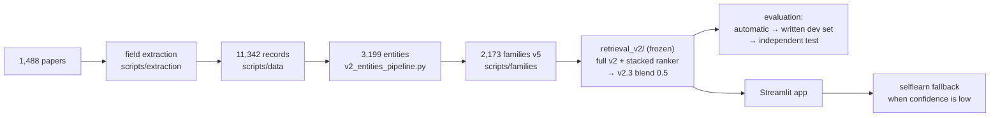

# Benchmark recommender for optimisation problems

**What it does.**

- You describe an optimisation problem in plain text. The system suggests five benchmark families that published papers
  used for similar problems.
- It retrieves from a knowledge base of 11,342 benchmark records in 1,488 conference papers, grouped into 2,173
  families. It combines lexical, dense and learned ranking, and shows the evidence papers behind each family.
- It recommends benchmarks, not algorithms. When its confidence is low, a fallback shortlists families by the stated
  problem features and keeps the suggestion as unverified, for a person to check.

## Workflow



The details are in `docs/architecture.md`.

## Quick start

**Install** (Python 3.13, CPU only):

```
python3.13 -m venv .venv
.venv/bin/pip install --index-url https://download.pytorch.org/whl/cpu torch==2.15.0+cpu
.venv/bin/pip install -r requirements-dev.txt
source .venv/bin/activate
```

**Run the app.**

| mode | command | notes |
|---|---|---|
| live | `app/run_demo.sh` | runs v2.3 on your own text after checking the frozen hashes; about 1.8 GB installed, a 1.4 to 1.5 GB memory peak, 7 to 16 s to the first answer |
| precomputed | `streamlit run app/streamlit_app.py` | shows the precomputed examples only; needs only `app/requirements.txt` |

**Run the tests and the integrity checks:**

```
python -m pytest tests -q
grep -v "^#" retrieval_v2/evaluation/FROZEN_HASHES.txt | sha256sum -c --strict
grep -v "^#" retrieval_v2/evaluation/FROZEN_HASHES_v23.txt | sha256sum -c --strict
```

**Hosted demo: TODO, not deployed yet** (`docs/deployment.md`).

## How the results were obtained

All numbers come from `retrieval_v2/RESULTS.md`. Intervals are 95% bootstrap intervals. The method is in
`docs/methodology.md`.

**Pre-registration.** The evaluation was pre-registered before each stage:

- `retrieval_v2/evaluation/PREREGISTRATION.md` (automatic evaluation);
- `PREREGISTRATION_queries.md` (written development queries);
- `PREREGISTRATION_final.md` with amendments 1 to 6 (independent test).

**Primary claim: the stacked ranker.** It was tested on 60 independent written queries (sets t1, t3 and t4), scored
once on 12 November 2026.

- Its hit@5 minus popularity's is **+0.350 [+0.217, +0.483]** (paired bootstrap; supported).
- A cluster bootstrap over 38 groups of queries sharing a gold family gives +0.350 [+0.176, +0.530].
- Stacked hit@5 is 0.433 [0.317, 0.567]; popularity's is 0.083 [0.017, 0.167].

**Product: the blend (v2.3, blend 0.5).** It was chosen after seeing the test, by the pre-registered decision rule.

- Its MRR advantage over the stacked ranker was +0.132 [+0.067, +0.202].
- Its test numbers are therefore **selection numbers**: hit@5 0.500 [0.383, 0.633], MRR 0.385 [0.285, 0.500].

**Automatic evaluation** (five folds by paper, masked queries; criterion met on both seeds).

| seed | stacked hit@5 | popularity hit@5 |
|---|---|---|
| 42 | .376 [.337, .421] | .328 [.290, .371] |
| 43 | .352 [.314, .392] | .310 [.268, .349] |

On the same evaluation, the blend's hit@5 is .190 [.158, .222] (seed 42), below popularity.

## Limitations

The main ones are below. The full list is in `docs/limitations.md`.

- **Small, overlapping test.** The test has n = 60, its topics overlap across sets, and t1 and t4 share a writer. On t3
  alone, the advantage over popularity has an interval that includes 0.
- **Rare gold families.** 70% of the test's gold families have fewer than 2 papers. Applied questions often return
  families backed by a single paper.
- **The evaluations disagree on the blend.** It beats popularity on written questions but not on the automatic
  evaluation.
- **Score bands are not validated.** The bands are experimental, and they did not rise in order on the test.
- **The fallback is weak and its check is descriptive.**
  - Its confidence trigger has Youden's J 0.197 on the development set.
  - Its hold-out check (87 of 126 pairs "either"; 11 of 35 same-group) is not an accuracy.
  - For the constrained example it misses the CEC 2006 suite.
- **No source links.** No source paper has a DOI or URL in the data.
- **Hosting.** The hosted mode shows precomputed examples only, and the learned store is empty and read-only there.

## Repository map

| path | content |
|---|---|
| `retrieval_v2/` | **frozen** retrieval system (v2, v2.1 stacked, v2.2 blend, v2.3 product wrapper) and `RESULTS.md` |
| `retrieval_v2/evaluation/` | folds, query sets, pre-registrations, provenance, scorers, reports, `FROZEN_HASHES*.txt`, `FROZEN_ENV.txt` |
| `selflearn/` | low-confidence fallback: extractor, matcher, trigger, learned store, verify command line (`docs/selflearning.md`) |
| `app/` | Streamlit demo (live and precomputed), gallery, site data, tools |
| `tests/` | `tests/app`, `tests/selflearn` |
| `scripts/` | build scripts for records, families and extraction (`scripts/README.md`) |
| `docs/` | architecture, methodology, data, deployment, limitations, audits, repository plan |
| `archive/` | superseded v1 code and data, older family layers, labelling packs (`archive/README.md`) |
| `data/incoming/` | raw PReMI extraction CSVs before ingest |
| repository root | frozen data files (records, embeddings, entities, families), the master tables, and the entity pipeline that frozen `evaluate.py` runs from the root (`docs/data.md`) |
| `backup_v1/`, `backup_v2/` | inputs read by the entity pipeline |

## How to cite

Cite the repository and the tag of the product system:

```
project_fyp: benchmark recommender for optimisation problems.
https://github.com/Viritha-D/project_fyp, tag retrieval-v2.3-blend, 2026.
Authors: TODO
```

A `CITATION.cff` will be added once the author list is confirmed.

## Licence

MIT. See `LICENSE`.
