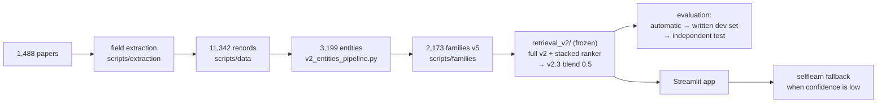

# Benchmark recommender for optimisation problems

**What it does.**

- You describe an optimisation problem in plain text. The system suggests five benchmark families that published papers
  used for similar problems.
- It retrieves from a knowledge base of 11,342 benchmark records in 1,488 conference papers, grouped into 2,173
  families. It combines keyword search, meaning-based (embedding) search and a learned ranker, and shows the evidence papers behind each family.
- It recommends benchmarks, not algorithms. When its confidence is low, a fallback shortlists families by the stated
  problem features and keeps the suggestion as unverified, for a person to check.

## Key terms

| term | meaning |
|---|---|
| benchmark family | a group of closely related test problems, such as "CEC 2017 suite" or "TSPLIB". The system recommends families. |
| entity | one distinct problem description found in the papers. Entities are grouped into families. |
| hit@5 | the share of questions for which at least one correct family is in the top 5 (0 to 1; higher is better) |
| MRR | mean reciprocal rank: 1 if the first correct family is ranked 1st, ½ if 2nd, and so on, averaged over questions |
| popularity | the baseline. It always suggests the families used by the most papers, whatever the question. |
| stacked ranker | the main model: a logistic regression that re-scores candidates from text search and from similar papers |
| blend 0.5 (v2.3) | the version the app runs. It combines, with equal weight, the ranks from the stacked ranker and from the text-search pipeline (keyword search plus sentence embeddings and a re-ranker). |
| frozen | code and data fixed by sha256 hashes before testing, so the tested system can't be changed afterwards |
| pre-registered | the test, its measures and its pass/fail rule were written down and committed before the test was run |
| selection numbers | results on the same data used to make a choice. They are optimistic, because the choice was fitted to that data. |
| t1, t3, t4 | the three independent test sets: 20 questions each, written by people who had not seen the system. Set t2 was rejected at intake. |

## Workflow



The details are in `docs/architecture.md`.

## Quick start

**Install** (Python 3.13, CPU only; about 1.8 GB):

```
python3.13 -m venv .venv
.venv/bin/pip install --index-url https://download.pytorch.org/whl/cpu torch==2.15.0+cpu
.venv/bin/pip install -r requirements-dev.txt      # live stack (app/requirements-live.txt) + pytest
source .venv/bin/activate
```

**Run the app.**

| mode | command | notes |
|---|---|---|
| live | `app/run_demo.sh` | answers your own questions. It checks the frozen hashes first. The first question downloads about 0.5 GB of models (internet needed) and takes 7 to 16 s. Memory peaks at 1.4 to 1.5 GB. |
| precomputed | `streamlit run app.py` | shows the precomputed examples only (the hosted mode); needs only `pip install -r requirements.txt` (streamlit, pandas, numpy) |

**Run the tests and the integrity checks:**

```
python -m pytest tests -q
grep -v "^#" retrieval_v2/evaluation/FROZEN_HASHES.txt | sha256sum -c --strict
grep -v "^#" retrieval_v2/evaluation/FROZEN_HASHES_v23.txt | sha256sum -c --strict
```

**Hosted demo: TODO, not deployed yet** (`docs/deployment.md`).

## How the results were obtained

**In short.** On 60 questions written by people who had not seen the system, the main model found a correct family in
its top 5 for 43% of questions, against 8% for the popularity baseline. That difference met the pass/fail rule written down before the test.
The app runs a slightly different version (the blend). It scored 50% on the same questions, but it was picked after
those results were seen, so its 50% is optimistic.

All numbers come from `retrieval_v2/RESULTS.md`. Brackets are 95% bootstrap intervals, a plausible range for the true
value given this sample. The method is in `docs/methodology.md`.

**Three stages, each written down before it was run:**

1. **Automatic evaluation** (`PREREGISTRATION.md`). Each paper's own fields, with benchmark names hidden, are used as a
   question, and the system is trained without that paper. It is repeated with two random splits (seeds).
2. **Written development questions** (`PREREGISTRATION_queries.md`). There are 55 questions, and they were used to tune
   choices, so their results are selection numbers.
3. **Independent test** (`PREREGISTRATION_final.md` and amendments 1 to 6). Sets t1, t3 and t4 (n = 60) were scored
   once, on 12 November 2026. All three files are in `retrieval_v2/evaluation/`.

**Primary claim: the stacked ranker beats popularity on the independent test.**

| measure | value |
|---|---|
| stacked minus popularity, hit@5 | **+0.350 [+0.217, +0.483]**: the interval is above 0, so the claim is supported |
| same, with similar questions resampled together (38 groups) | +0.350 [+0.176, +0.530] |
| stacked hit@5 | 0.433 [0.317, 0.567] |
| popularity hit@5 | 0.083 [0.017, 0.167] |

**Product: the blend (v2.3).** A rule fixed in advance said that the blend would replace the stacked ranker if its MRR
was clearly higher on the test. It was: +0.132 [+0.067, +0.202]. That choice was made after seeing the test, so the
blend's test numbers are selection numbers: hit@5 0.500 [0.383, 0.633], MRR 0.385 [0.285, 0.500].

**Automatic evaluation.** The criterion, written down in advance, was met on both seeds.

| seed | stacked hit@5 | popularity hit@5 |
|---|---|---|
| 42 | .376 [.337, .421] | .328 [.290, .371] |
| 43 | .352 [.314, .392] | .310 [.268, .349] |

On these automatic questions the blend does worse than popularity: hit@5 .190 [.158, .222] on seed 42.

## Limitations

The main ones are below. The full list is in `docs/limitations.md`.

- **Small, overlapping test.**
  - The test has only n = 60.
  - Some topics recur across the sets, and two of the three sets (t1 and t4) have the same writer.
  - On t3 alone, the advantage over popularity is not clear: its interval includes 0.
- **Rare gold families.** 70% of the correct families in the test appear in fewer than 2 papers. Questions about
  applied problems often return families that only one paper used.
- **The two evaluations disagree about the blend.** It beats popularity on the written questions but not on the
  automatic ones.
- **Score bands are not validated.** The 1-to-3 band shown with each answer is experimental, and on the test accuracy
  did not rise from the lowest band to the top band.
- **The fallback is weak.**
  - Its low-confidence trigger is weak (Youden's J 0.197, where 0 is no better than chance and 1 is perfect). It catches
    5 of 22 misses on the development questions.
  - Its hold-out check is descriptive, not an accuracy: 87 of 126 checks found a related family, and 11 of 35 found one
    in the same benchmark group.
  - For a heavily constrained example it misses the classic CEC 2006 constrained suite.
- **No source links.** The data has no DOI or URL for any source paper.
- **Hosting.** The hosted version shows precomputed examples only, and its store of learned suggestions is empty and
  read-only.

## Repository map

| path | content |
|---|---|
| `retrieval_v2/` | **frozen** retrieval system (v2, v2.1 stacked, v2.2 blend, v2.3 product wrapper) and `RESULTS.md` |
| `retrieval_v2/evaluation/` | folds, query sets, pre-registrations, provenance, scorers, reports, `FROZEN_HASHES*.txt`, `FROZEN_ENV.txt` |
| `selflearn/` | low-confidence fallback: extractor, matcher, trigger, learned store, verify command line (`docs/selflearning.md`) |
| `app.py` | entry point for Streamlit Cloud (runs `app/streamlit_app.py`) |
| `app/` | Streamlit demo (live and precomputed), gallery, site data, tools |
| `tests/` | `tests/app`, `tests/selflearn` |
| `scripts/` | build scripts for records, families and extraction (`scripts/README.md`) |
| `docs/` | architecture, methodology, data, deployment, limitations, audits, repository plan |
| `archive/` | superseded v1 code and data, older family layers, labelling packs (`archive/README.md`) |
| `data/incoming/` | raw PReMI extraction CSVs before ingest |
| repository root | frozen data files (records, embeddings, entities, families), the master tables, and the entity pipeline that frozen `evaluate.py` runs from the root (`docs/data.md`) |
| `backup_v1/`, `backup_v2/` | inputs read by the entity pipeline |

## How to cite

Cite the repository and the tag of the product system:

```
project_fyp: benchmark recommender for optimisation problems.
https://github.com/Viritha-D/project_fyp, tag retrieval-v2.3-blend, 2026.
Authors: TODO
```

A `CITATION.cff` will be added once the author list is confirmed.

## Licence

MIT. See `LICENSE`.
