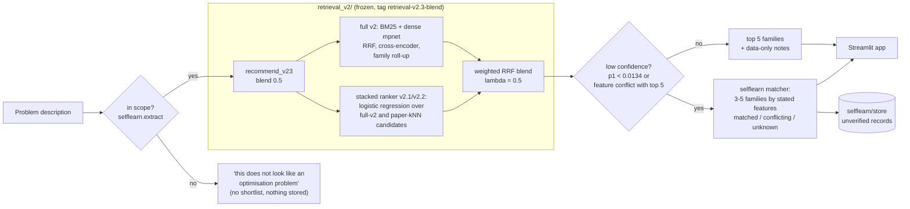

# Architecture

## Components



The diagram is the live path (local mode). The hosted app shows precomputed examples from `app/gallery.json`, and runs
no retrieval there.

## Layers and where they live

| layer | path | role |
|---|---|---|
| Records | `papers_master_with_matching_text_v2.csv` (root, frozen) | 11,342 benchmark records from 1,488 papers, with matching text |
| Paper embeddings | `paper_embeddings.npy` (root, frozen) | all-mpnet-base-v2 vectors of the matching text, one per record |
| Entities | `problem_entities_enriched_v2.json`, `entity_embeddings_v2.npy`, `entity_notes_v2.json`, `entity_ids_order_v2.txt`, `paper_to_entity_map_v2.csv` (root, frozen) | 3,199 problem entities, built by `v2_entities_pipeline.py` |
| Families | `families_v5.json`, `entity_to_family_v5.csv`, `family_notes_v5.json` (root, frozen) | 2,173 benchmark families (v5), built by `scripts/families/v5_families.py` |
| Retrieval | `retrieval_v2/hybrid.py` (frozen) | full v2: BM25 and dense search over entities, RRF (k = 60), cross-encoder (ms-marco-MiniLM-L-6-v2), family roll-up with an evidence bonus |
| Stacked ranker | `retrieval_v2/v21.py`, `v21_model.json`, `recommend_v21.py` (frozen) | hygiene index, paper-kNN voting (K = 100), logistic regression over 8 features, score bands |
| Blend | `retrieval_v2/v22/blend.py`, `recommend_v23.py` (frozen) | v2.3 = weighted reciprocal-rank blend of full v2 and the stacked ranking at λ = 0.5 |
| Fallback | `selflearn/` | out-of-scope gate, rule-based feature extraction, confidence and conflict triggers, feature matcher, learned store, verify CLI |
| App | `app/` | Streamlit UI: live mode (local, `run_demo.sh`) and precomputed mode (hosted); data-only notes; reliability panel from `app/site_data.json` |
| Evaluation | `retrieval_v2/evaluation/` | five-fold automatic evaluation, written query sets, pre-registrations, final test scorer and reports |

## Pinned build path

Frozen `retrieval_v2/evaluation/evaluate.py` rebuilds the training-only indexes by running `v2_entities_pipeline.py`
from the repository root.

- That script imports `part4_entities.py` and `part5_entities.py` and runs `entity_dedup_audit.py` and
  `find_true_duplicates.py`.
- It reads files at the root and in `backup_v1/` and `backup_v2/`.

These files therefore stay where they are, even though they are not frozen (`docs/REPO_PLAN.md`, section 2).

## Integrity checks

| file | what it fixes |
|---|---|
| `retrieval_v2/evaluation/FROZEN_HASHES.txt` | the 20 files of the frozen system |
| `retrieval_v2/evaluation/FROZEN_HASHES_v23.txt` | the 19 files v2.3 reads |
| `retrieval_v2/evaluation/FROZEN_ENV.txt` | the library versions in which the reproduction gate passed |

Verify the hashes with:

```
grep -v "^#" retrieval_v2/evaluation/FROZEN_HASHES.txt | sha256sum -c --strict
```
