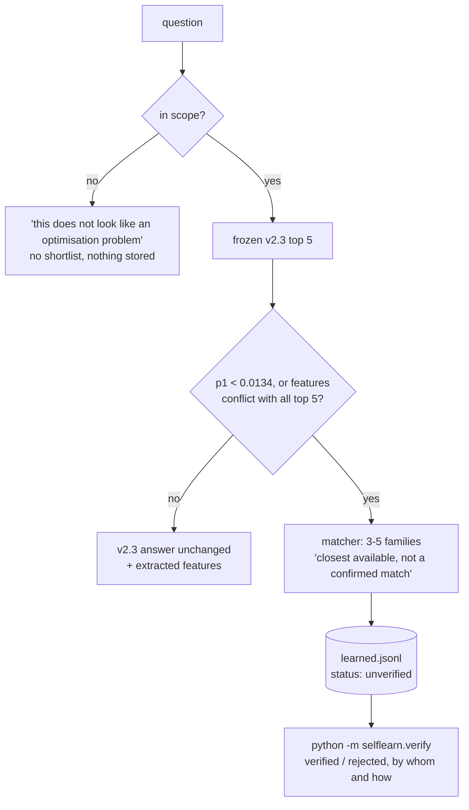

# Low-confidence fallback (`selflearn/`)

The fallback module sits outside the frozen retrieval system (`retrieval_v2/`, tag `retrieval-v2.3-blend`) and only
reads it. When the frozen blend 0.5 ranking has low confidence, the module does three things:

- it extracts the problem features stated in the question;
- it matches them to benchmark-family metadata;
- it keeps the suggestion, marked unverified, in a local store for a person to check.

It never reads the independent test queries or their gold labels. It changes no frozen file and no frozen ranking.

## Flow



## Parts

| file | role |
|---|---|
| `schema.py` | the feature schema: category, variable type, objectives, number of objectives, dimensionality, separability, modality, landscape tags, constraints. Each has fixed values plus "unknown". A feature the text does not state stays "unknown" and is never guessed. |
| `extract.py` | the rule-based extractor (keywords and regular expressions; no network, no API key), and the out-of-scope gate. Text is out of scope only when it has no optimisation vocabulary **and** no stated feature. |
| `profiles.py` | the family profiles: the same extractor applied to the metadata of each record in `papers_master_with_matching_text_v2.csv`, counted per family. Hygiene-excluded entities are left out. |
| `matcher.py` | compares the question's profile with each family. A known feature is matched (+1), conflicting (−1) or unknown (−0.25). A family is removed only on a certain objectives conflict. The score is the feature score divided by the number of known features, plus the best dense cosine to a member entity. The weights were fixed beforehand; nothing is tuned. |
| `trigger.py` | the low-confidence rule. p1 is the stacked probability of the blend's rank-1 family. The answer is low-confidence when p1 < threshold, or when the stated features conflict with every one of the top five (a fixed rule with no tunable value). The store is never consulted here. |
| `store.py`, `store/learned.jsonl` | the learned store: JSON lines in plain git, outside every frozen path. Records start as unverified. Duplicates are not added, and a rejected family is not suggested again for a similar profile. Unverified records never count as evidence. It is read-only in hosted mode. |
| `verify.py` | the command line for people: list records and mark each verified or rejected, with who checked and how. |
| `fallback.py` | puts the parts together for the app. |
| `tools/choose_threshold.py` | chooses the threshold on the development queries. |
| `tools/holdout_check.py` | the descriptive hold-out check and the blind review pack. |

## Threshold

The threshold was chosen on the 55 development queries (`queries_v2`) only. The v2.2 λ was also selected on this set.
The rule maximises Youden's J for predicting a miss (no gold family in the top 5) by p1 < t. The candidates are
midpoints between consecutive p1 values, and ties go to the smaller t. The output is `selflearn/threshold.json`
(2026-11-14).

| measure | value |
|---|---|
| threshold | p1 < 0.0134 |
| Youden's J | 0.197 |
| development queries / misses / hits | 55 / 22 / 33 |
| below the threshold | 6, of which 5 are misses |
| misses above the threshold | 17 |
| feature-conflict trigger | 1 |
| triggered by either rule | 7 |

**This is a weak trigger.** It catches 5 of 22 misses. It is a selection number on the set it was chosen on, so it is
expected to be lower on new questions.

## Hold-out check (descriptive)

This is post-hoc and descriptive, and covers development queries only. No accuracy is claimed for the module.

**Method.** For each family that is gold for a development query:

1. remove it from the matcher's candidates;
2. run the matcher for the queries that list it;
3. check whether the five-family shortlist holds a related family. "Related" means one of two things:
   - **same group:** the family shares a suite membership with the removed one;
   - **shares the key features:** it has equal majority values on every known key feature (category, variable type,
     objectives, constraints), with at least 2 such features known.

| measure | count |
|---|---|
| removed-family / query pairs | 126 (110 families, 55 queries) |
| shortlist holds a same-group family | 11 of 35 pairs where a group exists |
| shortlist holds a family sharing the key features | 85 of 126 |
| either | 87 of 126 |

**"Shares the key features" is a weak measure**, because common feature combinations are shared by many families. The
per-pair output is in `selflearn/holdout_check.csv`.

**Review pack.** `selflearn/review_pack.csv` has 442 rows for the 55 development queries. Each query lists the union
of the v2.3 top 5 and the module shortlist, in a fixed shuffled order, with an empty judgement column and no source
shown. The key for unblinding is `selflearn/review_pack_key.csv`. No human judgements have been collected yet.

## Worked example and known gaps

**Constrained example.** A differential-evolution question about many equality and inequality constraints and a small
feasible region triggers the fallback, because every v2.3 top-five family conflicts with "constrained".

- The shortlist is CEC 2010 suite, Obstacle-Aware Maximum Coverage Deployment, CEC 2024 suite, Berth and Quay Crane
  Assignment, and bar truss.
- It misses the CEC 2006 suite, because that suite's records are mostly tagged unconstrained in the data (19 records
  versus 5).

The other limits are listed in `docs/limitations.md`:

- the optional LLM extractor is not implemented, and setting `SELFLEARN_LLM_EXTRACTOR=1` raises an error;
- the store is empty and read-only when hosted;
- outside the app, `recommend_v23` still answers every text.

## Commands

```
python -m pytest tests/selflearn -q          # module tests
python -m selflearn.verify --help            # review stored suggestions
python -m selflearn.tools.choose_threshold   # re-derive the threshold (development queries only)
python -m selflearn.tools.holdout_check      # descriptive hold-out check + review pack
```
